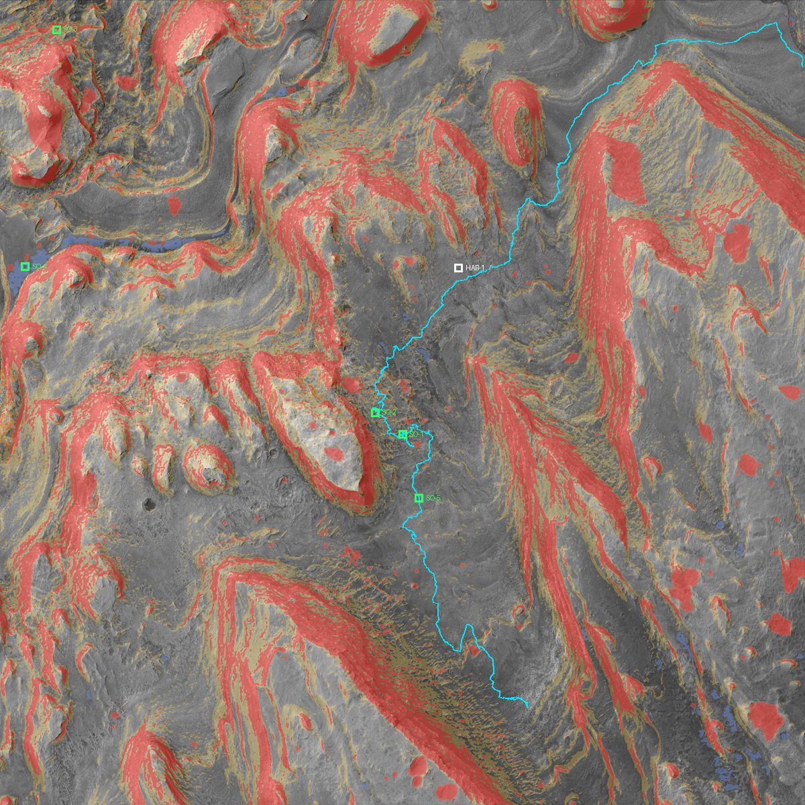

# Site Selection — ARES-1 / EVA 07

## Site
**Gale Crater · Mount Sharp boxwork region.** Chosen because:
- It is the challenge's own example (Curiosity studied boxwork ridges here in 2025–26).
- Trek serves HiRISE tiles of it at ~0.6 m/px, and USGS has a 1 m DEM and a 25 cm orthophoto covering it.
- Curiosity spent sols ~4476–4850 here, leaving a real traverse, hundreds of ground-level images per sol, and drill-sample chemistry.

## Curiosity in the boxwork region (from MMGIS MSL_waypoints.json)

| Sol | Lat | Lon (°E) | Elev (m, geoid) | Odometry (km) | Event |
|---|---|---|---|---|---|
| 4478 | −4.790833 | 137.391263 | −3707.6 | 34.05 | First views of the boxwork (sol 4476 panorama) |
| 4560 | −4.799847 | 137.383541 | −3647.2 | 35.01 | Entering the boxwork area |
| 4636 | −4.806538 | 137.379338 | −3607.1 | 35.74 | Close-up mosaic of mineral nodules |
| 4711–4752 | −4.808008 | 137.381004 | −3607.7 | 36.11 | Ridge-top drilling ("Nevado Sajama", sol 4722) |
| 4851 | −4.812015 | 137.382037 | −3588.0 | 36.66 | Upslope, leaving the boxwork |

Rover stops for sols 4540–4800 span lat −4.8087 to −4.7978, lon 137.3791 to 137.3859 (about 1.2 km × 0.4 km).

## EVA footprint
- Centre: **−4.806°, 137.381°E**
- Box: lat −4.8313 to −4.7807, lon 137.3557 to 137.4063 (≈ 3 km × 3 km)
- Fully inside the Trek HiRISE mosaic and the USGS 1 m DEM coverage (137.12–137.73°E, −4.93 to −4.25°).

## Waypoints (set by the Phase 1 pipeline)
Defined in [`app/src/lib/site.ts`](../app/src/lib/site.ts) and checked by `pipeline/validate.py`. Walks are the reference Dijkstra route on a 4 m grid from the habitat.

| ID | Name | Position | Walk from HAB-1 | Basis |
|---|---|---|---|---|
| HAB-1 | Habitat | −4.797546, 137.384531 | — | Flattest hazard-free 50 m pad within 400 m of the sol 4560 stop (mean slope 2.9°, max 6.0°). The original spot averaged 7.3° |
| SO-1 | Boxwork Ridge | −4.808008, 137.381004 | 767 m, max 18° | Ridge drill campaign, sols 4711–4752 |
| SO-2 | Nodule Outcrop | −4.806639, 137.379284 | 795 m, max 19° | Nodule close-up, sol 4636; moved 7 m off flagged ground |
| SO-3 | Fresh Crater Ejecta | −4.782548, 137.359242 | 3,058 m, max 25° | 19 m crater, 4.3 m deep (d/D 0.22, so young) |
| SO-4 | Dune Margin | −4.797461, 137.357285 | 3,058 m, max 24° | Edge of a 7,800 m² dark sand patch |
| SO-5 | Upslope Ridge Shelter | −4.812015, 137.382037 | 956 m, max 13° | Curiosity stop, sol 4851 |

SO-3 and SO-4 are a long out-and-back to the north-west (about 3 km each way). That suits a rover-assisted profile; a walking-only EVA would cover HAB → SO-1/SO-2/SO-5.

## POV imagery to collect (Phase 0 T0.5 → finished in Phase 6)
- NASA Image Library: PIA26559 (first 360° boxwork view), PIA26558 (fractured boxwork close-up), PIA26560, PIA26680, PIA26306 (HiRISE).
- Raw images API: Navcam/Mastcam frames for sols 4560, 4636 and 4722, with `mast_az` / `mast_el` for HUD placement.
