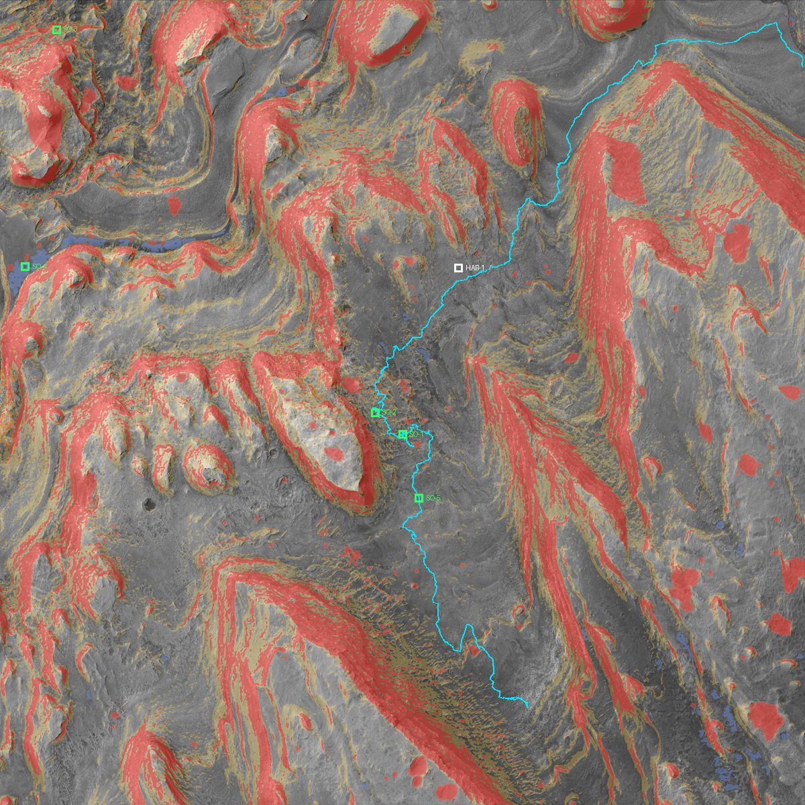

# Data pipeline

Builds the Gale boxwork data pack in `app/public/data/gale/` from NASA/USGS sources.

```bash
cd pipeline
python -m venv .venv
.venv/Scripts/python -m pip install -r requirements.txt   # macOS/Linux: .venv/bin/python
.venv/Scripts/python fetch.py      # ~5 min: DEM + orthophoto windows (range requests), THEMIS tiles
.venv/Scripts/python derive.py     # ~30 s: grids, overlays, tiles, mesh, vectors, site.json
.venv/Scripts/python validate.py   # checks + waypoint placement + reference walk
```

On Windows set `PYTHONIOENCODING=utf-8` so the console can print the report.

| Script | Does |
|---|---|
| `config.py` | Site bbox, Mars constants, source URLs (keep in sync with `app/src/lib/site.ts`) |
| `fetch.py` | Reads only the 3 km site window from the 3.9 GB DEM and 24 GB orthophoto, and mosaics THEMIS tiles. Cached in `.cache/` (git-ignored) |
| `derive.py` | Slope (5 m baseline), roughness, hillshade, contours, crater / rock / sand detection, 2 m nav grids, overlays, ortho tile pyramid, 3D heightfield, GeoJSON, `site.json` |
| `validate.py` | Grid sanity checks, habitat flatness, SO-3/SO-4 selection, stand-off snapping, Dijkstra walk from the habitat to every waypoint |

## Output (`app/public/data/gale/`)
- `site.json` — manifest: bounds, CRS, grid encodings, thresholds, file list, sources, method notes
- `grids/*.bin` — 1499×1499 cells at 2 m: elevation (u16), slope, roughness, rock density, THEMIS night IR, hazard bitmask (u8)
- `overlays/` — hillshade, slope, roughness, elevation, contours, hazards, THEMIS day/night, orthophoto (1 m)
- `tiles/{z}/{y}/{x}.jpg` — orthophoto pyramid, 16 m → 0.5 m per pixel
- `terrain/` — 1024² u16 heightfield + 2048² texture for the 3D view
- `vectors/` — craters, sand patches, Curiosity stops and traverse

## Hazard heuristics
These are a planning aid, not a certified hazard map. Details are in `site.json → method_notes`.
- **Slope:** >15° hard going, >25° impassable on foot. Curiosity's own path through the site has a median of 11° and a 95th percentile of 16° at this baseline.
- **Craters:** depressions from morphological closing, ≥1 m deep, 8–250 m across, near-circular. 196 found.
- **Rocky:** sub-metre orthophoto texture coinciding with DEM relief (2.5% of the site).
- **Sand:** dark, smooth, gentle ground in patches ≥300 m².
- **Thermal:** THEMIS night IR brightness as a thermal-inertia stand-in (81 m/px, coarse).


